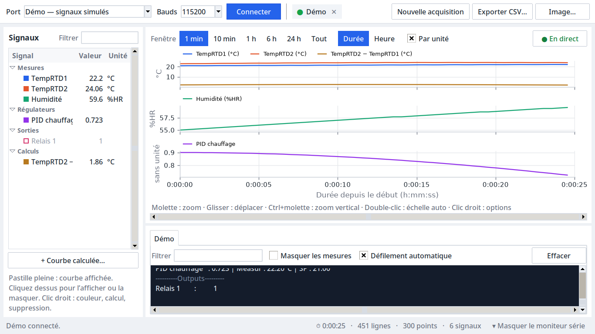

# Trace Série

Application Python avec interface graphique en français pour tracer des mesures
reçues sur plusieurs ports série dans un même graphique. Python **3.10 ou
supérieur** et Tkinter sont nécessaires.

## Ouvrir l’application

1. Décompressez le dossier complet dans un emplacement où vous pouvez écrire.
2. Ouvrez **lancer.pyw** avec Python. Sous Windows, un double-clic ouvre normalement
   l’application sans console. Sous Linux, autorisez son exécution dans les
   propriétés du fichier puis choisissez « Exécuter comme un programme » selon
   votre gestionnaire de fichiers. Un raccourci Linux `Trace Série.desktop` est
   également fourni : laissez-le dans le même dossier que `lancer.pyw`. Il suit
   maintenant le dossier décompressé, sans chemin fixé à l’avance.
3. Si des bibliothèques manquent, une fenêtre propose **Installer et ouvrir
   l’application**. Elle télécharge Matplotlib et pySerial dans un environnement
   `.venv` local au dossier. Cette première installation nécessite Internet.

Python et Tkinter doivent être installés avant de lancer le programme. Sous
Debian/Ubuntu, les paquets correspondants sont `python3`, `python3-tk` et
`python3-venv` ; sous Fedora, `python3` et `python3-tkinter`. Sous Windows,
conservez l’option Tcl/Tk dans l’installation de Python. Il n’est pas possible
d’afficher la fenêtre d’installation si Tkinter lui-même est absent. Le lanceur
essaie alors d’afficher un diagnostic avec les outils du bureau et l’enregistre
dans `demarrage.log` à côté de l’application (ou dans le dossier temporaire si
le dossier de l’application n’est pas accessible en écriture).

## Démarrage sous Linux Mint

1. Décompressez l’archive complète dans votre dossier personnel. N’ouvrez pas
   directement les fichiers à l’intérieur de l’archive ZIP.
2. Installez les paquets **python3-tk** et **python3-venv** avec le gestionnaire
   de paquets. Si vous préférez une commande, ouvrez un terminal et lancez :

   ```sh
   sudo apt update
   sudo apt install python3-tk python3-venv
   ```

3. Dans les propriétés de `Trace Série.desktop`, autorisez son exécution comme
   programme, puis ouvrez-le. Selon le bureau, acceptez « Autoriser le lancement »
   ou « Marquer comme fiable » si cette action est proposée. Gardez ce raccourci
   dans le dossier de l’application : le copier seul sur le bureau ne déplace pas
   le programme.
4. Une autre possibilité est d’ouvrir un terminal **dans le dossier décompressé**
   et de lancer `sh lancer-linux.sh`, ou `python3 lancer.pyw`. Le script Linux
   fonctionne aussi par double-clic si le gestionnaire de fichiers autorise
   l’exécution de scripts. L’utilisation de l’application reste entièrement graphique.
5. Si rien ne s’ouvre, consultez **demarrage.log** dans ce dossier. Il est créé dès
   le lancement, puis conserve les étapes et la sortie du processus local, même
   en cas de plantage natif. Le lanceur attend la confirmation de la fenêtre et
   signale une sortie prématurée ou un échec (délai de démarrage maximal : 90 s).
   Les erreurs
   pendant l’installation des dépendances restent dans **installation.log**.
   Notez aussi le résultat de `python3 --version` : Python 3.10 minimum est requis.

Le raccourci des anciennes archives contenait un chemin absolu vers le dossier
de création. Remplacez-le par celui de cette archive. Si vous ne pouvez pas
exécuter un raccourci, le lancement `python3 lancer.pyw` permet de distinguer
un problème du gestionnaire de fichiers d’un problème de l’application.

### Si NumPy plante avec « Illegal instruction » ou « SIGILL »

Ce plantage natif peut provenir d’instructions processeur incompatibles dans les
bibliothèques numériques téléchargées par pip. Il échappe aux exceptions Python.
La [documentation NumPy](https://numpy.org/doc/stable/user/troubleshooting-importerror.html)
explique notamment les problèmes de détection des capacités CPU dans certaines
machines virtuelles. La trace seule ne permet pas de déterminer quelle
instruction ni quelle configuration matérielle est responsable.

Une solution de repli sous Mint est d’utiliser ses paquets système au lieu des
bibliothèques du dossier `.venv`. Installez une fois :

```sh
sudo apt update
sudo apt install python3-tk python3-numpy python3-matplotlib python3-serial
```

Puis ouvrez **Trace Série Mint.desktop**, ou exécutez dans le dossier du programme :

```sh
sh lancer-mint.sh
```

Ce lanceur utilise `/usr/bin/python3 -s`, retire `PYTHONPATH` et `PYTHONHOME` de
l’environnement du processus, et ignore `.venv`. Il ne supprime ni cet
environnement, ni vos fichiers CSV. Il ne réinstalle pas de paquets avec pip.
Il nécessite Python 3.10+ et Matplotlib 3.6+ comme le programme principal.
Gardez le raccourci Mint dans le même dossier que les autres fichiers.

Pour tester immédiatement une ancienne copie de l’application après installation
de ces paquets, la commande
`env -u PYTHONPATH -u PYTHONHOME /usr/bin/python3 -s interface.py` contourne également
le lanceur et le dossier `.venv`.

Pour un environnement Python déjà géré, l’alternative est :

```sh
python3 -m pip install -r requirements.txt
python3 lancer.pyw
```

Toutes les opérations de mesure, configuration et export se font ensuite dans
la fenêtre, sans console.

## Utilisation



La fenêtre a quatre zones :

- en haut, la **barre des appareils** : port, débit, **Connecter**, une pastille par
  appareil connecté, puis **Nouvelle acquisition**, **Exporter CSV…** et **Image…** ;
- à gauche, la liste des **signaux** détectés, avec leur dernière valeur ;
- au centre, le **graphique** ;
- sous le graphique, le bandeau **Mesures** quand des signaux y sont ajoutés ;
- en bas, le **moniteur série** (un onglet par appareil), repliable depuis la barre d’état.

Pour agrandir le graphique, **◂ Signaux** (Ctrl+B), à gauche de la barre du graphique,
masque la liste des signaux ; **▸ Signaux** la réaffiche. Le moniteur se replie avec
**Masquer le moniteur série** dans la barre d’état. Ces choix sont retenus.

### Connecter un appareil

1. Choisissez le **port** dans la liste (elle se met à jour à l’ouverture) ou
   saisissez-le : `/dev/ttyACM0`, `ttyACM0`, `acm0`, `/dev/ttyUSB0`, `usb0`, `COM3`,
   `/dev/serial/by-id/…`. Choisissez le **débit** (115200 par défaut).
2. Cliquez sur **Connecter** (ou Entrée). Une pastille apparaît : verte quand le port
   est ouvert, orange pendant une (re)connexion, rouge en cas d’erreur. Survolez-la
   pour le détail ; cliquez dessus pour afficher ses sorties ; **✕** la déconnecte.
3. Répétez pour d’autres appareils, chacun avec son débit. Tous partagent le même
   axe des temps.

L’entrée **Démo — signaux simulés** imite la sortie d’un OPC (mesures, régulateur,
sortie, défaut de sonde périodique) pour essayer l’application sans matériel.

**Reconnexion automatique** : si l’appareil disparaît (câble, redémarrage, flashage
du Pico), le port est rouvert chaque seconde, sans perdre les mesures ni remettre le
temps à zéro. S’il revient sous un autre nom (`ttyACM1`…), il est retrouvé par son
numéro de série USB.

### Signaux

Chaque ligne `Nom : valeur unité` crée automatiquement un signal ; l’unité est lue
dans la ligne. Rien à saisir. Les signaux sont rangés par section quand l’appareil
en imprime (`-------Measurements-------` de l’OPC devient **Mesures**, puis
**Régulateurs**, **Actionneurs**, **Sorties**…).

- La **pastille** de couleur indique si le signal est tracé : pleine = affiché,
  creuse = masqué. Cliquez dessus (ou double-cliquez sur la ligne, ou Espace) pour
  basculer. Par défaut, seules les **mesures** sont tracées.
- **Clic droit** : Afficher/Masquer, Afficher seulement la sélection, **Mesures**, Couleur…,
  **Graphe séparé** (le signal reçoit son propre axe), Courbe calculée…, Supprimer.
- **Filtrer** réduit la liste aux noms qui contiennent le texte saisi.
- Une mesure en défaut (`TempRTD2 : Circuit ouvert`) affiche son état en rouge dans
  la colonne Valeur et coupe la courbe jusqu’à la prochaine valeur.

Les couleurs et l’état affiché/masqué de chaque nom sont retenus pour les lancements
suivants, comme le port, le débit et les réglages du graphique.

### Graphique

- **Fenêtre** : 1 min, 10 min, 1 h, 6 h, 24 h ou Tout. L’axe grandit jusqu’à cette
  durée puis défile avec les dernières mesures.
- **Durée / Heure** : temps écoulé depuis le début (h:mm:ss) ou heure locale du PC.
- **Par unité** : un graphe par unité (°C, %HR…), alignés sur le même temps. Décoché,
  toutes les courbes partagent un seul axe.
- **● En direct / ⏸ Figé** : cliquez pour figer la vue pendant que l’acquisition
  continue ; recliquez (ou touche Fin) pour revenir au direct.

À la souris, sur le graphique :

| Geste | Effet |
| --- | --- |
| Molette | zoom sur le temps (en direct, le bord droit reste sur la dernière mesure) |
| Glisser | déplacer dans l’historique (la vue se fige) |
| Maj + molette | défiler dans le temps |
| Ctrl + molette | zoom vertical du graphe survolé |
| Double-clic | échelle verticale automatique du graphe survolé |
| Clic droit | échelle automatique ou fixée (min/max), direct, tout l’historique, image |

En survolant le graphique, la ligne sous les courbes donne l’instant pointé et la
valeur de chaque courbe à cet instant. La barre de défilement horizontale permet
aussi de parcourir l’historique. Les points hors écran restent dans l’export.

**Image…** (Ctrl+S) enregistre le graphique en PNG, SVG ou PDF, légendes comprises.

### Mesures

Comme sur un oscilloscope : clic droit sur un ou plusieurs signaux → **Mesures
(moyenne, médiane, min, max…)**, ou clic droit sur un graphe → **Mesures des courbes
de ce graphe**. Un bandeau apparaît sous le graphique, avec une ligne par signal :

| Colonne | Contenu |
| --- | --- |
| Moyenne, Médiane | des valeurs reçues |
| Min, Max | valeurs extrêmes |
| Crête-crête | Max − Min |
| Écart-type | dispersion autour de la moyenne |
| Points | nombre de mesures prises en compte |

- **Vue affichée** calcule sur la plage visible : un zoom ou un déplacement met les
  mesures à jour, ce qui permet de mesurer un palier ou une oscillation précise.
  **Toute l’acquisition** calcule depuis le début. Les deux suivent les nouvelles mesures.
- **Repères sur le graphe** trace la moyenne (tirets) et le min/max (pointillés) dans
  la couleur de la courbe.
- Sélectionner une ligne affiche dans la barre d’état les instants du min et du max.
- Clic droit ou Suppr retire une ligne ; **✕** ferme le bandeau.
- Les points en défaut (trous) sont ignorés. Toutes les mesures sont des statistiques
  sur les échantillons reçus : un signal envoyé irrégulièrement n’est pas pondéré par
  la durée.

### Moniteur série

Un onglet par appareil garde ses 2 000 dernières lignes, même replié. Les mesures
sont en blanc, les messages (événements, démarrage…) en jaune, les états de défaut
en rouge et les en-têtes de section en gris. **Filtrer** n’affiche que les lignes
contenant le texte ; **Masquer les mesures** ne garde que les messages ; **Effacer**
vide l’onglet sans toucher aux mesures.

### Acquisition et export

Le temps démarre à la première connexion. **Nouvelle acquisition** efface les mesures
et remet le temps à zéro en conservant appareils, signaux, couleurs et calculs ; une
confirmation est demandée si des mesures n’ont pas été exportées. Fermer
l’application propose aussi d’exporter.

**Exporter CSV…** (Ctrl+E) enregistre toutes les mesures reçues, y compris pendant
l’acquisition ; l’écriture se fait en arrière-plan.

Une variable est identifiée par **son port et son nom** : deux appareils peuvent
envoyer `TempRTD1` sans mélanger les mesures ; leur port est alors indiqué dans la
liste, la légende et l’export.

## Courbes calculées

**+ Courbe calculée…** (ou clic droit → Courbe calculée…) ouvre une fenêtre : choisissez
**A**, l’**opération** (soustraction, addition, multiplication, division) et **B** ;
**⇅ Inverser** échange A et B. Le résultat et son unité sont affichés avant l’ajout,
et une combinaison invalide est expliquée. Si deux signaux sont sélectionnés dans la
liste, ils sont proposés comme A et B.

La courbe apparaît dans le groupe **Calculs** sous le nom `A − B` (exportée sous
`Math 1 — A − B`). Les opérandes peuvent venir de ports différents, ou être eux-mêmes
des courbes calculées.

Le calcul reprend les données déjà enregistrées puis continue en direct. Il ne
produit aucun point tant que les deux entrées ne sont pas connues. Ensuite, chaque
nouvelle valeur de l’une des entrées déclenche le calcul avec la dernière valeur
connue de l’autre, sans interpolation. Au même instant, le point calculé est mis à
jour au lieu d’être dupliqué. Une division par zéro, un résultat non fini ou une
entrée en défaut crée un trou dans la courbe et une cellule CSV vide.

L’addition et la soustraction nécessitent des étiquettes d’unité identiques.
La multiplication et la division combinent les étiquettes d’unité ; le quotient
de deux unités identiques est affiché sans unité. Ces opérations travaillent sur
les nombres reçus, sans conversion physique des unités. Supprimer un signal supprime
aussi les calculs qui en dépendent.

## Format reçu

Une mesure par ligne, sous la forme `Nom : nombre unité`, comme l’imprime l’OPC :

```text
===== Process Control =====
-------Measurements-------
TempRTD1        :      22.12 °C
TempRTD2        : Circuit ouvert
Pression : 1.013e3 hPa
--------Regulators--------
PID1            : 0.420 | Measur : 22.12°C | SP : 21.00
```

- Le nom avant `:` est repris exactement, majuscules comprises ; les espaces autour
  sont ignorés. `TempRTD1` et `TempRTD10` sont deux signaux.
- Le nombre doit suivre immédiatement `:` (espaces permis) ; virgule ou point décimal.
  L’unité est le premier mot qui suit (`°C`, `%HR`…) ; `| Measur : …` n’est pas une unité.
- Une ligne `Nom : texte` sur un signal déjà connu est un **état** (défaut) ; elle ne
  crée pas de nouveau signal. Les horodatages (`12:03:44`) et les noms qui ne
  commencent pas par une lettre ne créent pas de signal non plus.
- Une ligne encadrée de tirets ou de `=` (`-----Outputs-----`) donne la section des
  signaux qui suivent.
- Les autres lignes restent visibles dans le moniteur. Les fins de ligne LF, CRLF et
  CR sont acceptées, même coupées entre deux lectures. L’entrée est décodée en UTF-8 ;
  les caractères invalides sont remplacés. Plus de 64 Ko sans fin de ligne (débit
  erroné) sont ignorés avec un message dans le moniteur, sans couper la lecture.

Le temps correspond à la réception sur l’ordinateur, et non à une horloge embarquée.
Sous Linux, il continue d’avancer pendant la mise en veille de l’ordinateur : les
mesures de la période de veille manquent, mais l’horodatage reste juste.

## Fichier CSV

Encodage UTF-8 avec BOM, séparateur `;`, point décimal :

```csv
horodatage;temps_s;TempRTD1 (°C);TempRTD2 (°C)
2026-09-16T21:00:01.250+02:00;1.250000;22.115;
2026-09-16T21:00:01.400+02:00;1.400000;;23.2
2026-09-16T21:00:01.500+02:00;1.500000;22.3;23.4
```

Chaque signal (affiché ou non) a sa colonne **Nom (unité)**, ou **Nom** sans unité.
Une ligne regroupe toutes les mesures ayant le même **temps_s**, à la microseconde,
y compris celles de ports différents. Les colonnes sans mesure à cet instant restent
vides : ni interpolation ni répétition. Les lignes sont triées par temps de réception ;
si une même variable a plusieurs valeurs au même temps exporté, la dernière est retenue.
Une mesure en défaut laisse une cellule vide.

Si deux colonnes auraient le même titre, le port est ajouté pour les distinguer,
par exemple `TempRTD1 (°C) [/dev/ttyACM0]` et `TempRTD1 (°C) [/dev/ttyACM1]`.
Dans un tableur français, choisissez le point comme séparateur décimal à l’import si
les nombres sont lus comme du texte.

## Points pratiques

- Paramètres série : 8 bits, sans parité, 1 bit de stop (8N1), sans contrôle de flux.
- Fermez le moniteur série Arduino/PlatformIO ou tout autre programme qui utilise
  le même port (l’ouverture est exclusive sous Linux). Certains appareils redémarrent
  à l’ouverture du port série.
- Sous Linux, l’accès au périphérique nécessite les droits du groupe approprié
  (souvent `dialout`, parfois `uucp`). L’erreur s’affiche au survol de la pastille et
  dans la barre d’état ; la connexion est retentée chaque seconde.
- Les mesures sont gardées en mémoire (16 octets par point : 24 h à 10 lignes/s sur
  6 signaux occupent de 85 à 170 Mo). Il n’y a pas de sauvegarde automatique sur
  disque : exportez. Le graphique reste fluide quelle que soit la durée, car seuls
  un minimum et un maximum par colonne de pixels sont tracés.
- Les réglages sont dans `~/.config/trace-serie/preferences.json` (Linux),
  `%APPDATA%\trace-serie\preferences.json` (Windows). Supprimez ce fichier pour
  revenir aux réglages d’origine. Les courbes calculées ne sont pas conservées.

## Organisation du code et vérification

- `lancer.pyw` : démarrage et installation graphique des dépendances manquantes.
- `lancer-linux.sh` : lancement Linux depuis n’importe quel dossier courant.
- `lancer-mint.sh` : lancement avec le Python et les bibliothèques de Linux Mint,
  en contournant `.venv` et les paquets Python du site utilisateur.
- `interface.py` : fenêtre, liste des signaux, commandes et moniteur série.
- `plot_view.py` : graphiques par unité, décimation min/max, graduations du temps.
- `time_view.py` : durée visible, suivi, zoom et déplacement dans l’historique.
- `acquisition.py` : lecture en arrière-plan avec reconnexion, analyse des lignes,
  stockage numpy, calculs et export CSV.
- `preferences.py` : réglages conservés entre deux lancements.
- `tests/` : analyse des lignes et sections, lignes fragmentées, détection des
  signaux, défauts, CSV, calculs, fenêtre temporelle, décimation, graduations,
  port série virtuel POSIX (déconnexion et reconnexion) et lanceur.

```sh
python3 -m unittest discover -s tests -v
```

Bibliothèques utilisées : [Tkinter](https://docs.python.org/3/library/tkinter.html),
[Matplotlib intégré dans Tk](https://matplotlib.org/stable/gallery/user_interfaces/embedding_in_tk_sgskip.html)
et [pySerial](https://pyserial.readthedocs.io/en/latest/pyserial_api.html).

Paquets Linux Mint : [python3-tk](https://community.linuxmint.com/software/view/python3-tk)
et [python3-venv](https://community.linuxmint.com/software/view/python3-venv).
Le raccourci suit la [spécification Desktop Entry](https://specifications.freedesktop.org/desktop-entry/latest-single/).
